<div align="center">
  <picture>
    <source media="(prefers-color-scheme: dark)" srcset="./docs/images/rapidocrlite_logo_dark.svg">
    
  </picture>

<div>&nbsp;</div>
<div align="center">
    <b><font size="4"><i>信创级开源OCR - 为世界内容安全贡献力量</i></font></b>
</div>
<div>&nbsp;</div>

<a href="https://clawhub.ai/rapidai/rapidocr" target="_blank"></a>
<a href="https://huggingface.co/spaces/RapidAI/RapidOCRv3" target="_blank"></a>
<a href="https://www.modelscope.cn/studios/RapidAI/RapidOCRv3.0.0/summary" target="_blank"></a>
<a href="https://colab.research.google.com/github/RapidAI/RapidOCR/blob/main/assets/RapidOCRDemo.ipynb" target="_blank"></a>
<a href="">=3.9-aff.svg"></a>
<a href=""></a>
<a href="https://github.com/RapidAI/RapidOCRLite/graphs/contributors"></a>
<a href="https://pepy.tech/project/rapidocr"></a>
<a href="https://pypi.org/project/RapidOCRLite/"></a>
<a href="https://github.com/RapidAI/RapidOCRLite/stargazers"></a>
<a href="https://semver.org/"></a>
<a href="https://github.com/psf/black"></a>

加入我们的 [Discord](https://discord.gg/33eyQJq498)

简体中文 | [English](./README.md)
</div>

<div align="center">

[](https://www.douyin.com/video/7698023726318767386)

**[🎬 社区用户制作的宣传视频：RapidOCRLite 轻量级开源OCR引擎（抖音）](https://www.douyin.com/video/7698023726318767386)**

<sub>由社区用户自发制作，感谢社区的支持！</sub>

</div>

**RapidOCRLite**（PyPI 名 `RapidOCRLite`，5.0.0a6）是 RapidOCR 的轻量快速版：C++ 实现的 PP-OCRv6 引擎，带 C ABI、C++ API，以及导入名仍为 `rapidocr`、API 与 RapidOCR 完全兼容的 Python 包。基于 ONNX Runtime 的 3.x 线（最新标签 `v3.9.2`）留在 [RapidAI/RapidOCR](https://github.com/RapidAI/RapidOCR)。上方徽章里的在线演示跑的是 3.x。

### 🧪 `model_type="lite"`（实验性：内置 Indra OCR 权重）

`RapidOCR(params={"Det.model_type": "lite", "Rec.model_type": "lite"})` 使用仓库内置的 [Indra OCR](https://huggingface.co/datalab-to/indra-ocr) 模型（`python/src/rapidocr/models/lite/`，约 17.1 MB），不需要下载。

- **许可证不同。** 这些权重**不属于** Apache-2.0，适用修改版 OpenRAIL-M（见 `models/lite/LICENSE`、`NOTICE`），有以下使用限制：
  - 上一年收入或融资超过 2000 万美元的主体，只能用于个人或研究用途。
  - 提供与 Datalab 竞争的产品或服务的主体，不得使用。
  - 输出同样受该许可证约束（第 8 条）。
- **运行方式。** 全部原生：所有模型和图像预处理都由 librapidocrlite 的 C++ 内核执行；流水线代码取自 indra-ocr 0.3.2（Apache-2.0，`python/src/rapidocr/_indra_vendor/`）。运行时不需要 onnxruntime、OpenCV 或 indra-ocr。`PPOCR_INDRA_BACKEND=ort` 改用上游 onnxruntime 流水线，仅作测试参照（需自行安装 `indra-ocr==0.3.2`）。
- **公开接口不变。** 与 PP-OCRv6 的差别：框为轴对齐矩形，`txts` 按阅读顺序排列，`box_thresh` / `unclip_ratio` 不生效。

### 🖼️ lite 与 PP-OCR 效果对照（参考样例）

下面 6 个样例分别用默认 **PP-OCRv6 small** 模型和内置 **lite** 模型识别，供选型参考。所有识别结果按原样展示，未做修改。

**如何阅读：**

- **检测框图**：蓝框 = PP-OCRv6 small，红框 = lite；框左上角的数字是该行在输出中的顺序，也就是引擎给出的阅读顺序。
- **白描图**：在与原图同尺寸的白底上，把每行识别出的文字按其框的位置、高度、长度和角度用黑色重新绘制（竖排框逐字竖写）。白描图越接近原图，说明漏检和错字越少；空白处表示该处没有检出文字。PP-OCR 的框较紧、lite 的框带外扩，因此 lite 白描的字形看起来略小，这不代表识别差异。
- **测试平台**：x86_64 Intel Xeon（8 vCPU，AVX-512，共享虚拟机），rapidocrlite 5.0.0a8 wheel，Python API；两种模型均为 4 线程、`use_cls=False`；时间为预热 1 次后 3 次运行的中位数，包含检测、识别和排序。
- 逐行框、文字、置信度见 [`docs/lite_examples/results/`](docs/lite_examples/results)；图片来源和许可见 [`docs/lite_examples/SOURCES.md`](docs/lite_examples/SOURCES.md)；复现脚本：`docs/lite_examples/run_compare.py`（识别）和 `docs/lite_examples/render_redraw.py`（白描图）。
- **总结**：lite 适合印刷文档（扫描件、多栏、表格），这类场景阅读顺序更好、速度更快；海报、拍照、场景文字和竖排请使用默认 PP-OCR 模型。

#### ① 合成扫描报告：双栏正文 + 表格

**图片内容**：自行生成的中文年度简报：标题、两栏正文、6 行 4 列的带线表格和脚注；整页旋转 2.5°，并加了纸张底色、噪声、轻微模糊和 JPEG 压缩，模拟扫描件。难点：双栏的阅读顺序、表格单元格的顺序、轻微倾斜与扫描噪声。

<table>
<tr><td colspan="2" align="center">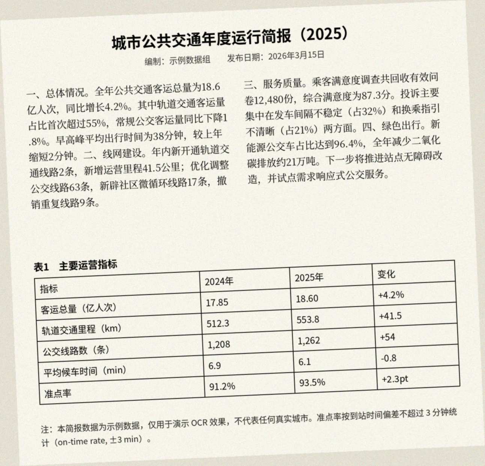<br><sub>原图（<code>synthetic_scan_report.jpg</code>）</sub></td></tr>
<tr><td width="420" align="center" valign="top">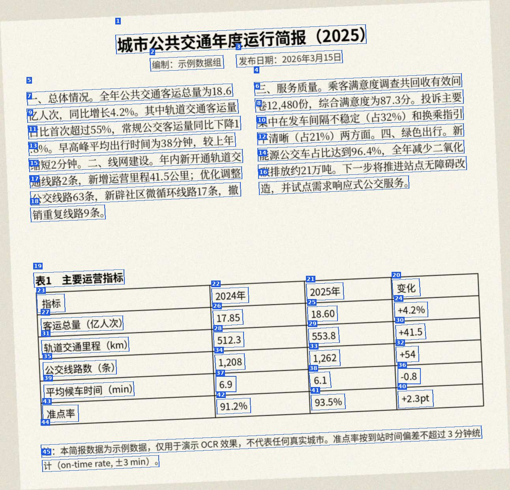<br><sub>PP-OCRv6 small 检测框（蓝），编号 = 阅读顺序；45 行，637.8 ms</sub></td><td width="420" align="center" valign="top">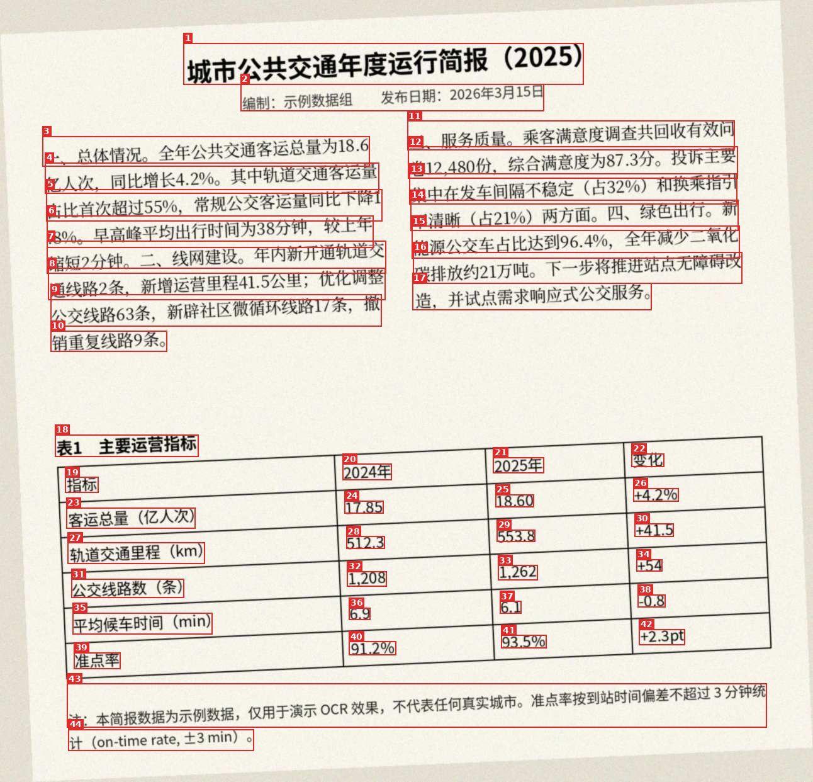<br><sub>lite 检测框（红），编号 = 阅读顺序；44 行，81.7 ms</sub></td></tr>
<tr><td width="420" align="center" valign="top">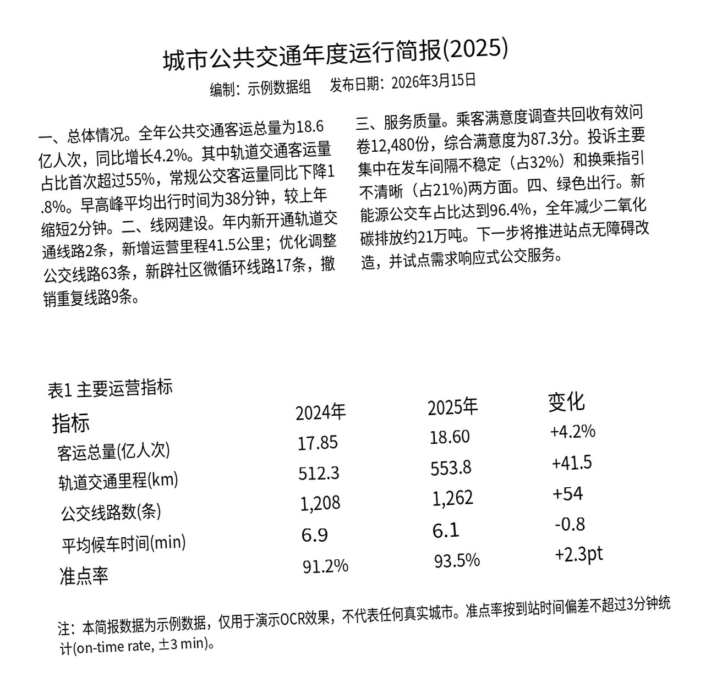<br><sub>PP-OCRv6 small 白描图：识别文字按框位置重绘</sub></td><td width="420" align="center" valign="top">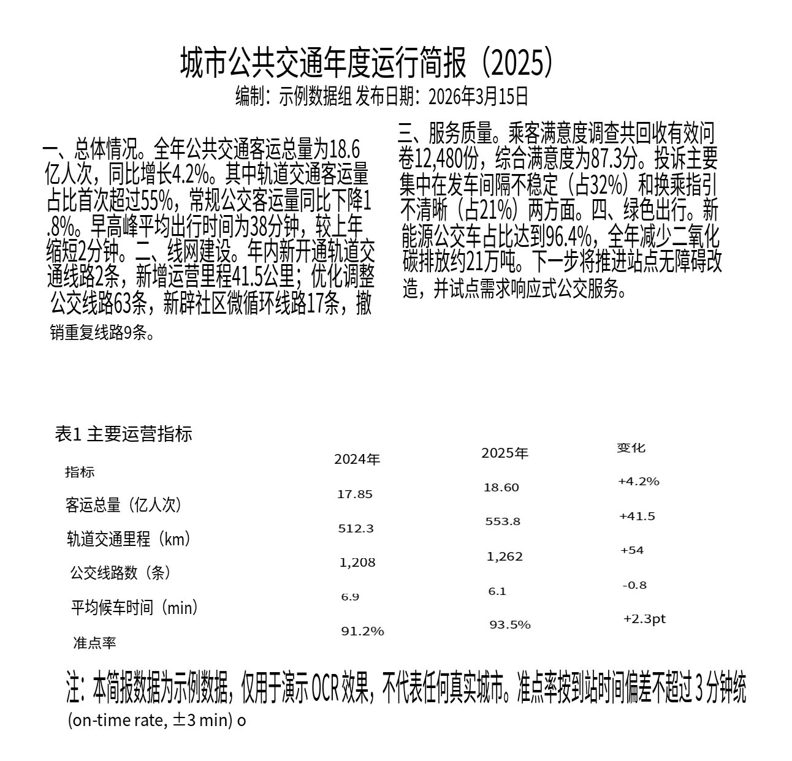<br><sub>lite 白描图：识别文字按框位置重绘</sub></td></tr>
</table>

- PP-OCR：45 行，文字基本全对；但两栏被逐行交错输出（左栏一行、右栏一行），表格每行内部顺序打乱（如“变化 / 2025年 / 2024年 / 指标”）；“编制”与“发布日期”被拆成两行。
- lite：44 行，文字基本全对；先输出整个左栏、再输出右栏，表格按“指标 / 2024年 / 2025年 / 变化”逐行输出，阅读顺序与原文一致；末行“。”被识别为“o”。
- **结论**：lite 更好（阅读顺序）。

<details><summary>PP-OCRv6 small 识别结果（按阅读顺序）</summary>

```text
1. 城市公共交通年度运行简报(2025)
2. 编制：示例数据组
3. 发布日期：2026年3月15日
4. 三、服务质量。乘客满意度调查共回收有效问
5. 一、总体情况。全年公共交通客运总量为18.6
6. 卷12,480份，综合满意度为87.3分。投诉主要
7. 亿人次，同比增长4.2%。其中轨道交通客运量
8. 集中在发车间隔不稳定（占32%）和换乘指引
9. 占比首次超过55%，常规公交客运量同比下降1
10. 不清晰（占21%)两方面。四、绿色出行。新
11. .8%。早高峰平均出行时间为38分钟，较上年
12. 能源公交车占比达到96.4%，全年减少二氧化
13. 缩短2分钟。二、线网建设。年内新开通轨道交
14. 碳排放约21万吨。下一步将推进站点无障碍改
15. 通线路2条，新增运营里程41.5公里；优化调整
16. 造，并试点需求响应式公交服务。
17. 公交线路63条，新辟社区微循环线路17条，撤
18. 销重复线路9条。
19. 表1 主要运营指标
20. 变化
21. 2025年
22. 2024年
23. 指标
24. +4.2%
25. 18.60
26. 17.85
27. 客运总量(亿人次)
28. 512.3
29. 553.8
30. +41.5
31. 轨道交通里程(km)
32. +54
33. 1,262
34. 1,208
35. 公交线路数(条)
36. -0.8
37. 6.9
38. 6.1
39. 平均候车时间(min)
40. +2.3pt
41. 93.5%
42. 91.2%
43. 准点率
44. 注：本简报数据为示例数据，仅用于演示OCR效果，不代表任何真实城市。准点率按到站时间偏差不超过3分钟统
45. 计(on-time rate, ±3 min)。
```

</details>

<details><summary>lite 识别结果（按阅读顺序）</summary>

```text
1. 城市公共交通年度运行简报（2025）
2. 编制：示例数据组 发布日期：2026年3月15日
3. 一、总体情况。全年公共交通客运总量为18.6
4. 亿人次，同比增长4.2%。其中轨道交通客运量
5. 占比首次超过55%，常规公交客运量同比下降1
6. .8%。早高峰平均出行时间为38分钟，较上年
7. 缩短2分钟。二、线网建设。年内新开通轨道交
8. 通线路2条，新增运营里程41.5公里；优化调整
9. 公交线路63条，新辟社区微循环线路17条，撤
10. 销重复线路9条。
11. 三、服务质量。乘客满意度调查共回收有效问
12. 卷12,480份，综合满意度为87.3分。投诉主要
13. 集中在发车间隔不稳定（占32%）和换乘指引
14. 不清晰（占21%）两方面。四、绿色出行。新
15. 能源公交车占比达到96.4%，全年减少二氧化
16. 碳排放约21万吨。下一步将推进站点无障碍改
17. 造，并试点需求响应式公交服务。
18. 表1 主要运营指标
19. 指标
20. 2024年
21. 2025年
22. 变化
23. 客运总量（亿人次）
24. 17.85
25. 18.60
26. +4.2%
27. 轨道交通里程（km）
28. 512.3
29. 553.8
30. +41.5
31. 公交线路数（条）
32. 1,208
33. 1,262
34. +54
35. 平均候车时间（min）
36. 6.9
37. 6.1
38. -0.8
39. 准点率
40. 91.2%
41. 93.5%
42. +2.3pt
43. 注：本简报数据为示例数据，仅用于演示 OCR 效果，不代表任何真实城市。准点率按到站时间偏差不超过 3 分钟统
44.  (on-time rate, ±3 min) o
```

</details>

#### ② 密集小字：中英文混排技术说明

**图片内容**：自行生成的部署说明：7 段 17 px 小字，中文夹杂命令、环境变量、代码片段（如 <code>PPOCR_INDRA_METAL=2</code>、<code>rpocr_options_init(&amp;o)</code>）和全角标点。难点：字小行密、中英文和符号混排、长行自动换行。

<table>
<tr><td colspan="2" align="center">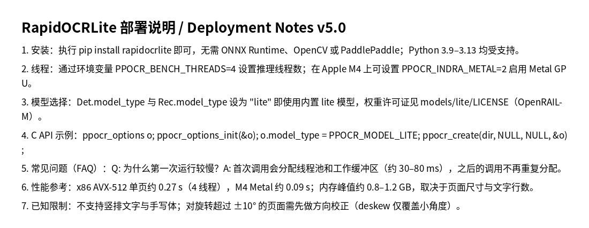<br><sub>原图（<code>synthetic_dense_mixed.png</code>）</sub></td></tr>
<tr><td width="420" align="center" valign="top">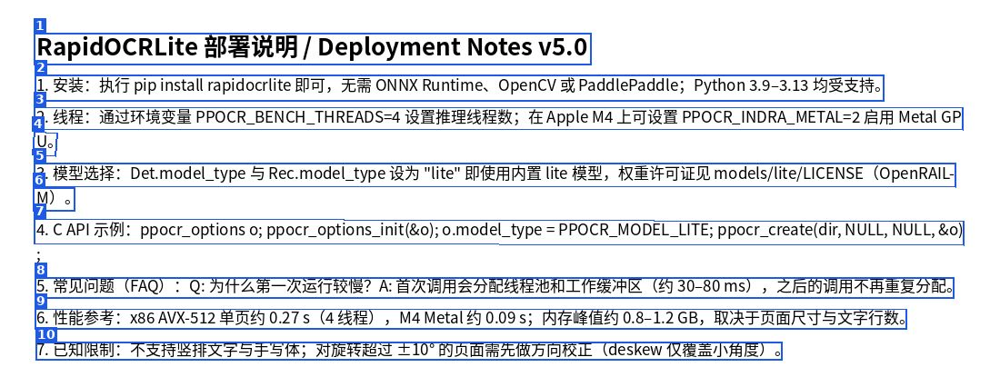<br><sub>PP-OCRv6 small 检测框（蓝），编号 = 阅读顺序；10 行，552.9 ms</sub></td><td width="420" align="center" valign="top">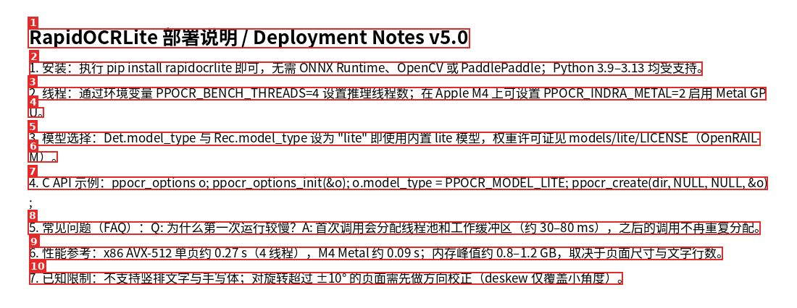<br><sub>lite 检测框（红），编号 = 阅读顺序；10 行，60.7 ms</sub></td></tr>
<tr><td width="420" align="center" valign="top">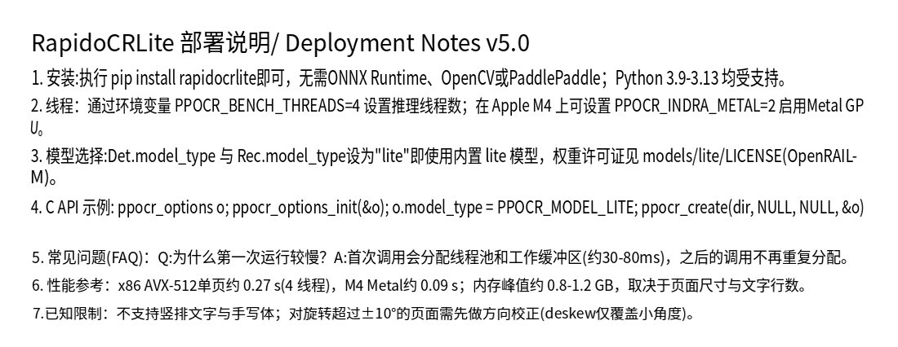<br><sub>PP-OCRv6 small 白描图：识别文字按框位置重绘</sub></td><td width="420" align="center" valign="top">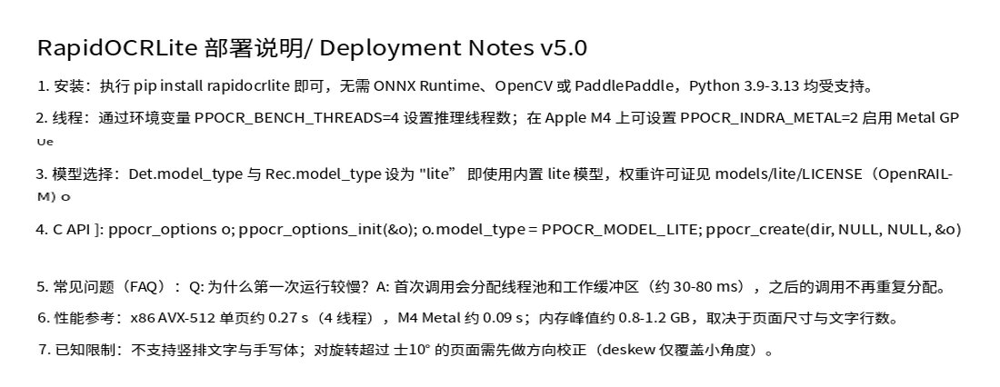<br><sub>lite 白描图：识别文字按框位置重绘</sub></td></tr>
</table>

- PP-OCR：10 行，几乎全对；“RapidOCR”识别为“RapidoCR”，部分中文全角标点被识别为半角（如“：”“（”）。
- lite：10 行，几乎全对，全角标点更准确；个别错误：“示例”→“]”，“±”→“士”，换行处的“U。”“M)。”识别为“Ue”“M) o”。
- **结论**：基本持平。

<details><summary>PP-OCRv6 small 识别结果（按阅读顺序）</summary>

```text
1. RapidoCRLite 部署说明/ Deployment Notes v5.0
2. 1. 安装:执行 pip install rapidocrlite即可，无需ONNX Runtime、OpenCV或PaddlePaddle；Python 3.9-3.13 均受支持。
3. 2. 线程：通过环境变量 PPOCR_BENCH_THREADS=4 设置推理线程数；在 Apple M4 上可设置 PPOCR_INDRA_METAL=2 启用Metal GP
4. U。
5. 3. 模型选择:Det.model_type 与 Rec.model_type设为"lite"即使用内置 lite 模型，权重许可证见 models/lite/LICENSE(OpenRAIL-
6. M)。
7. 4. C API 示例: rpocr_options o; rpocr_options_init(&o); o.model_type = RPOCR_MODEL_LITE; rpocr_create(dir, NULL, NULL, &o)
8. 5. 常见问题(FAQ)：Q:为什么第一次运行较慢？A:首次调用会分配线程池和工作缓冲区(约30-80ms)，之后的调用不再重复分配。
9. 6. 性能参考：x86 AVX-512单页约 0.27 s(4 线程)，M4 Metal约 0.09 s；内存峰值约 0.8-1.2 GB，取决于页面尺寸与文字行数。
10. 7.已知限制：不支持竖排文字与手写体；对旋转超过±10°的页面需先做方向校正(deskew仅覆盖小角度)。
```

</details>

<details><summary>lite 识别结果（按阅读顺序）</summary>

```text
1. RapidOCRLite 部署说明/ Deployment Notes v5.0
2. 1. 安装：执行 pip install rapidocrlite 即可，无需 ONNX Runtime、OpenCV 或 PaddlePaddle，Python 3.9-3.13 均受支持。
3. 2. 线程：通过环境变量 PPOCR_BENCH_THREADS=4 设置推理线程数；在 Apple M4 上可设置 PPOCR_INDRA_METAL=2 启用 Metal GP
4. Ue
5. 3. 模型选择：Det.model_type 与 Rec.model_type 设为 "lite” 即使用内置 lite 模型，权重许可证见 models/lite/LICENSE（OpenRAIL-
6. M) o
7. 4. C API ]: rpocr_options o; rpocr_options_init(&o); o.model_type = RPOCR_MODEL_LITE; rpocr_create(dir, NULL, NULL, &o)
8. 5. 常见问题（FAQ）：Q: 为什么第一次运行较慢？A: 首次调用会分配线程池和工作缓冲区（约 30-80 ms），之后的调用不再重复分配。
9. 6. 性能参考：x86 AVX-512 单页约 0.27 s（4 线程），M4 Metal 约 0.09 s；内存峰值约 0.8-1.2 GB，取决于页面尺寸与文字行数。
10. 7. 已知限制：不支持竖排文字与手写体；对旋转超过 士10° 的页面需先做方向校正（deskew 仅覆盖小角度）。
```

</details>

#### ③ 电商海报：艺术字、彩色背景

**图片内容**：来自 RapidOCR 测试集的商品促销海报：大号艺术字标题、彩色渐变背景、价格数字、小字标签和图标。难点：艺术字体、描边/阴影、彩色背景、字号差异很大。

<table>
<tr><td colspan="2" align="center"><br><sub>原图（<code>ch_en_num.jpg</code>）</sub></td></tr>
<tr><td width="420" align="center" valign="top"><br><sub>PP-OCRv6 small 检测框（蓝），编号 = 阅读顺序；18 行，212.7 ms</sub></td><td width="420" align="center" valign="top"><br><sub>lite 检测框（红），编号 = 阅读顺序；16 行，35.2 ms</sub></td></tr>
<tr><td width="420" align="center" valign="top">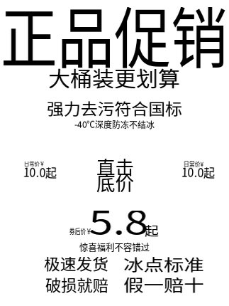<br><sub>PP-OCRv6 small 白描图：识别文字按框位置重绘</sub></td><td width="420" align="center" valign="top">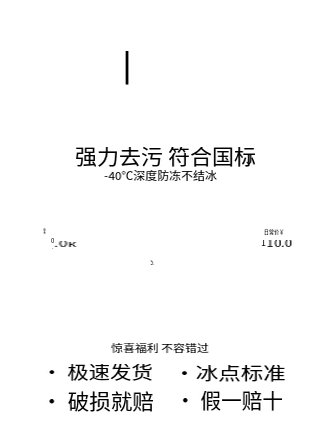<br><sub>lite 白描图：识别文字按框位置重绘</sub></td></tr>
</table>

- PP-OCR：18 行，基本全对，包括“正品促销”“大桶装更划算”“直击/底价”“5.8”“券后价￥”等。
- lite：16 行，漏掉“正品促销”“大桶装 更划算”“直击底价”等艺术字，价格只识别出“10.0”“5.”等片段，另有“|”“J”“常”等噪声行；“强力去污 符合国标”、底部四个标签识别正确。
- **结论**：PP-OCR 明显更好。

<details><summary>PP-OCRv6 small 识别结果（按阅读顺序）</summary>

```text
1. 正品促销
2. 大桶装更划算
3. 强力去污符合国标
4. -40℃深度防冻不结冰
5. 10.0起
6. 日常价￥
7. 直击
8. 底价
9. 10.0起
10. 日常价¥
11. 5.8
12. 券后价￥
13. 起
14. 惊喜福利不容错过
15. 极速发货
16. 冰点标准
17. 破损就赔
18. 假一赔十
```

</details>

<details><summary>lite 识别结果（按阅读顺序）</summary>

```text
1. |
2. 强力去污 符合国标
3. J
4. -40℃深度防冻不结冰
5. 常
6. 0.
7. .0к
8. 日常价￥
9. 1
10. 10.0
11. 5.
12. 惊喜福利 不容错过
13. • 极速发货
14. •冰点标准
15. • 破损就赔
16. • 假一赔十
```

</details>

#### ④ 拍照登记表：表格线、红框、水印

**图片内容**：来自 RapidOCR 测试集的机动车登记证书页照片：表格线、淡色打印字、红色标注框和“滴滴家园”水印。难点：手机拍摄、淡色小字、红框与水印干扰。

<table>
<tr><td colspan="2" align="center">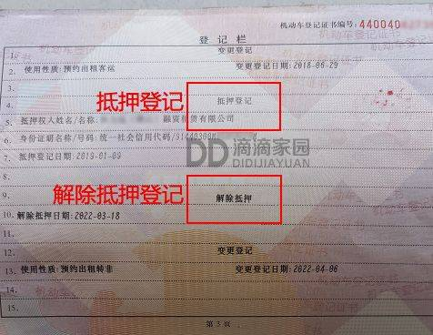<br><sub>原图（<code>check_return_word_len.jpeg</code>）</sub></td></tr>
<tr><td width="420" align="center" valign="top">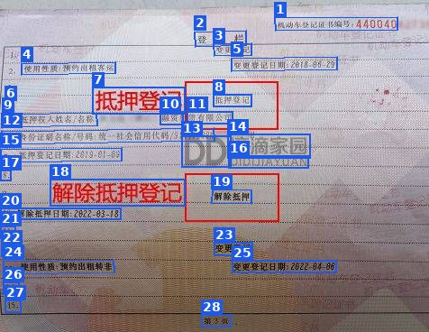<br><sub>PP-OCRv6 small 检测框（蓝），编号 = 阅读顺序；28 行，310.0 ms</sub></td><td width="420" align="center" valign="top">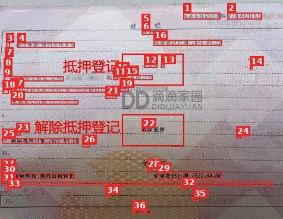<br><sub>lite 检测框（红），编号 = 阅读顺序；36 行，98.0 ms</sub></td></tr>
<tr><td width="420" align="center" valign="top">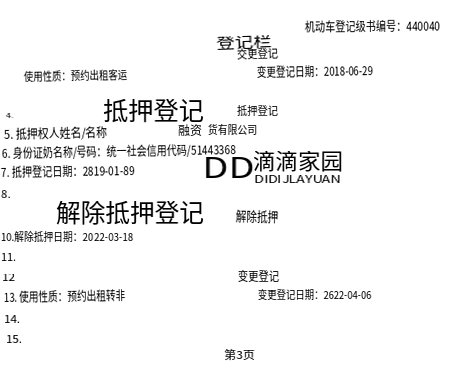<br><sub>PP-OCRv6 small 白描图：识别文字按框位置重绘</sub></td><td width="420" align="center" valign="top">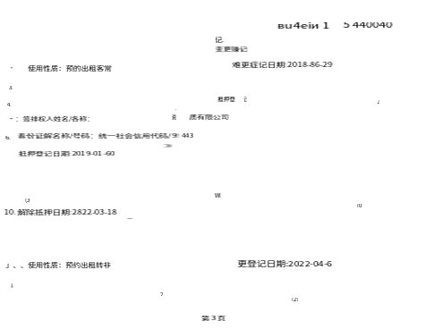<br><sub>lite 白描图：识别文字按框位置重绘</sub></td></tr>
</table>

- PP-OCR：28 行，整体可读，但有错误：“登记级书编号”“身份证奶名称”、日期“2819-01-89”“2622-04-06”。
- lite：36 行，错字较多（“预的出租客常”“变更赚记”“推押登”“难更症记”），日期“2018-86-29”“2822-03-18”出错，并输出不少“_”“•”“(3”等噪声行；未识别出水印文字。
- **结论**：PP-OCR 更好。

<details><summary>PP-OCRv6 small 识别结果（按阅读顺序）</summary>

```text
1. 机动车登记级书编号：440040
2. 登记栏
3. 交更登记
4. 使用性质：预约出租客运
5. 变更登记日期：2018-06-29
6. 4.
7. 抵押登记
8. 抵押登记
9. 5. 抵押权人姓名/名称
10. 融资
11. 货有限公司
12. 6. 身份证奶名称/号码：统一社会信用代码/51443368
13. DD
14. 滴滴家园
15. 7. 抵押登记日期：2819-01-89
16. DIDIJLAYUAN
17. 8.
18. 解除抵押登记
19. 解除抵押
20. 10.解除抵押日期：2022-03-18
21. 11.
22. 12
23. 变更登记
24. 13. 使用性质：预约出租转非
25. 变更登记日期：2622-04-06
26. 14.
27. 15.
28. 第3页
```

</details>

<details><summary>lite 识别结果（按阅读顺序）</summary>

```text
1. вu4eiи 1
2. 5 440040
3. •
4. 使用性质：预的出租客常
5. 记.
6. 变更赚记
7. 3.
8. 4.
9. •：签排权人姓名/各称：
10. •
11. 资
12. 推押登
13. 记
14. 2
15. 质有限公司
16. 难更症记日期:2018-86-29
17. 奏份证解名称/号码：统一社会信用代码/9!
18. 6.
19. 443
20. 抵押登记日期:2019-01-60
21. )
22. WI
23. (3
24. (0
25. 10. 解除抵押日期:2822-03-18
26. -
27. _
28. __
29. 更登记日期:2022-04-6
30. 」、、使用性质：预约出租转非
31. _
32. -
33. A
34. 2.
35. (2)
36. 第 3页
```

</details>

#### ⑤ 场景文字：灯箱招牌

**图片内容**：来自 RapidOCR 测试集的街头灯箱招牌照片：深色背景上的白字，含电话号码。难点：场景照片、拍摄角度、强对比和局部裁切。

<table>
<tr><td colspan="2" align="center"><br><sub>原图（<code>return_word_debug.jpg</code>）</sub></td></tr>
<tr><td width="420" align="center" valign="top">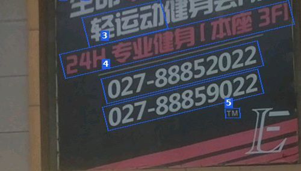<br><sub>PP-OCRv6 small 检测框（蓝），编号 = 阅读顺序；5 行，220.0 ms</sub></td><td width="420" align="center" valign="top">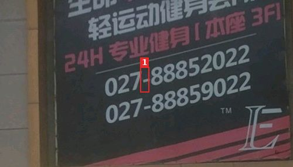<br><sub>lite 检测框（红），编号 = 阅读顺序；1 行，16.4 ms</sub></td></tr>
<tr><td width="420" align="center" valign="top"><br><sub>PP-OCRv6 small 白描图：识别文字按框位置重绘</sub></td><td width="420" align="center" valign="top"><br><sub>lite 白描图：识别文字按框位置重绘</sub></td></tr>
</table>

- PP-OCR：5 行，识别出“轻运动”“24H专业健身|本座3F1”“027-88852022”“027-88859022”“TM”。
- lite：只输出 1 个噪声行（“-”），几乎没有检出文字。
- **结论**：PP-OCR 明显更好。

<details><summary>PP-OCRv6 small 识别结果（按阅读顺序）</summary>

```text
1. 轻运动
2. 24H专业健身|本座3F1
3. 027-88852022
4. 027-88859022
5. TM
```

</details>

<details><summary>lite 识别结果（按阅读顺序）</summary>

```text
1. -
```

</details>

#### ⑥ 竖排繁体文字

**图片内容**：来自 RapidOCR 测试集的竖排繁体古籍片段，共 3 列。难点：竖排、繁体字、从右到左的列顺序。

<table>
<tr><td colspan="2" align="center">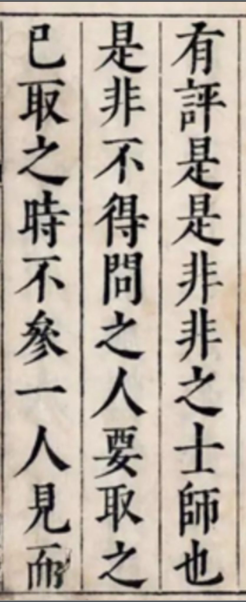<br><sub>原图（<code>text_vertical_words.jpg</code>）</sub></td></tr>
<tr><td width="420" align="center" valign="top">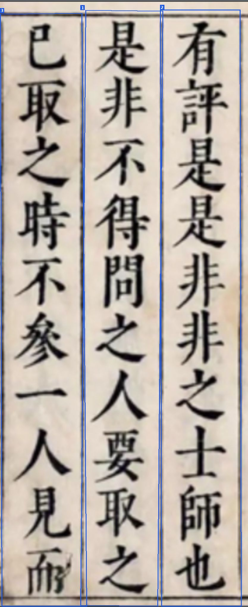<br><sub>PP-OCRv6 small 检测框（蓝），编号 = 阅读顺序；3 行，391.3 ms</sub></td><td width="420" align="center" valign="top">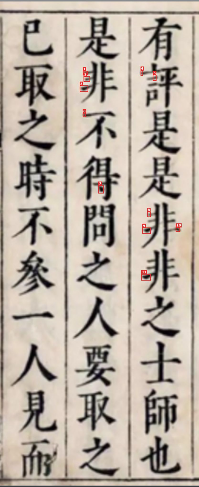<br><sub>lite 检测框（红），编号 = 阅读顺序；11 行，23.3 ms</sub></td></tr>
<tr><td width="420" align="center" valign="top"><br><sub>PP-OCRv6 small 白描图：识别文字按框位置重绘</sub></td><td width="420" align="center" valign="top"><br><sub>lite 白描图：识别文字按框位置重绘</sub></td></tr>
</table>

- PP-OCR：检出 3 列，文字全部正确（“有評是是非非之士師也”等），但列顺序不是从右到左（第 2 列排在第 1 列之前）。
- lite：不支持竖排，只输出 11 个标点状噪声行（“•”“-”等）。
- **结论**：PP-OCR 明显更好。

<details><summary>PP-OCRv6 small 识别结果（按阅读顺序）</summary>

```text
1. 是非不得問之人要取之
2. 有評是是非非之士師也
3. 已取之時不參一人見而
```

</details>

<details><summary>lite 识别结果（按阅读顺序）</summary>

```text
1. •
2. -
3. -
4. .
5. •
6. •
7. •
8. •
9. •
10. •
11. -
```

</details>

### 📝 简介

RapidOCR 是面向小模型、离线部署的开源 OCR。5.x 保留 3.x 应用已经在用的 `RapidOCR()` 调用，推理改由本仓库里的 PP-OCRv6 引擎完成，不再经过 ONNX Runtime。

解释器实现官方 PP-OCRv6 tiny / small / medium ONNX 检测器和识别器图里用到的算子：卷积、GEMM、池化、归一化、resize、形状算子、attention matmul，以及 DB / CTC 后处理。它是 PP-OCRv6 运行时，通用 ONNX 模型仍需要别的引擎。

如果本项目对你的工作有帮助，欢迎点一颗 ⭐ Star。

### ✨ 功能

- C++ PP-OCRv6 检测与识别。库不链接 ONNX Runtime、Paddle Inference 或 OpenCV。
- 同一个二进制在运行时分派到 AVX-512、AVX2+FMA 或 AArch64 NEON。`PPOCR_FORCE_ISA=scalar|avx2|avx512|neon` 只选择当前 CPU 合法的路径。只有 AVX2 的机器不会执行 AVX-512 目标文件。
- LoongArch（loongarch64，Linux）：LSX（la64v1.0 基线）通过 `src/neon_lsx_shim.hpp` 复用 NEON 代码路径；仅当 `getauxval(AT_HWCAP)` 报告 LASX 时才进入 LASX GEMM（FMA、4 行分块）、深度卷积、GELU、CTC argmax、逐元素、融合 ExpandGeluProjectAdd，门控的融合 depthwise+pointwise 3x3/5x5，以及门控的融合 depthwise+ExpandGelu 3x3 内核（`PPOCR_FORCE_ISA=lasx|lsx|scalar`）。用 `cmake/toolchains/loongarch64-linux-gnu.cmake` 交叉编译，只在 QEMU 用户模式下验证（CI 任务 `loongarch64 qemu`：文本与 `expected_cpu_texts.json` 一致，原始分数与 x86 相差约 4e-5 以内；LASX 内核的运算顺序与 LSX 不同，分数与 LSX 可能相差约 1e-6，文本不变）。没有真机性能数据；CI 产出 C/C++ SDK 压缩包，以及只发布到 GitHub Release 的 `manylinux_2_38_loongarch64` CPython 3.9–3.13 wheel（PyPI 不接受 loongarch64 标签）；这些 wheel 在 QEMU（Debian loong64）中做安装和 OCR 测试，文本与 x86 参考结果一致。Java fat jar 也内置 `native/linux-loongarch64/`，同样只在 QEMU（Debian loong64 OpenJDK）中验证，OCR 文本与 x86_64 一致。
- 可选 Vulkan 计算。源码构建在存在 `third_party/Vulkan-Headers` 和 `glslangValidator` 时嵌入 SPIR-V（`PPOCR_ENABLE_VULKAN` 默认 `ON`）。加载器通过 `dlopen` / `LoadLibrary` 打开 `libvulkan.so.1` 或 `vulkan-1.dll`，因此 Vulkan 不是 `DT_NEEDED` 依赖。发布的 wheel 传入 `-DPPOCR_ENABLE_VULKAN=OFF`。
- C ABI（`include/rapidocrlite/rapidocrlite.h`）、C++ API（`include/rapidocrlite/rapidocrlite.hpp`）和 Python 包 `rapidocr`。Python 用 ctypes 调用 C ABI。
- Python 调用形式跟随 3.x：`RapidOCR(params={"Section.key": value})`，然后使用 `result.txts`、`result.scores`、`result.boxes`、`result.elapse`、`to_json()`、`to_markdown()` 和 `vis()`。
- 缺少的模型会按 `default_models.yaml` 里的 ModelScope 地址下载（文件名与 3.x 相同；PP-OCRv6 文件取自标签 `v3.10.0`），保存到 `Global.model_root_dir`，并校验 SHA256。

### 🎥 效果展示

<div align="center">
    
</div>

动画是 RapidOCR 3.x 的网页演示。本分支核对过的单行样例是 [`python/tests/data/hello.png`](python/tests/data/hello.png)（960×240）上的 `Hello RapidOCR 123`。

### ⚡ 性能

这些计时用的是 PP-OCRv6 **tiny** ONNX。Python 默认（`RapidOCR()` 不传模型路径）是 PP-OCRv6 **small**，与 3.x 相同。`use_cls=False`，方向分类器不参与计时。

| 样例 | 尺寸 | 内容 |
| --- | --- | --- |
| hello | 960×240 | 一行：`Hello RapidOCR 123`（`python/tests/data/hello.png`） |
| page | 1700×2200 | 45 行。该页是本地测速图，没有提交进本仓库。 |

**x86，Python 墙钟。** 4 vCPU Intel Xeon（family 6，model 207），具备 AVX2 与 AVX-512F/DQ/BW/VL，恒定 2.4 GHz，`g++` 13.3，Python 3.12。默认线程池为 4（`min(16, hardware_concurrency)`）。强制 AVX2 只加在 5.0.0a1 进程的 `PPOCR_FORCE_ISA=avx2` 上；这台 CPU 上的 ONNX Runtime 1.30.0 仍走 AVX-512。每个数字是一次预热之后 8 次调用的中位数。两边都用 Python 的共同默认（`config.yaml`：短边限制 736，mean/std 0.5，开启膨胀）。960×240 的短行会被放大到短边 736。`rapidocr==3.9.2` 发布包自己的默认是 PP-OCRv6 **small** 且分类器开启；那种配置这次没有计时。

| 包 | hello | page |
| --- | --- | --- |
| rapidocr 5.0.0a1，AVX-512 | 105.1 ms | 356.7 ms |
| rapidocr 5.0.0a1，AVX2 | 119.1 ms | 454.7 ms |
| rapidocr 3.9.2（ORT 1.30.0） | 193.0 ms | 508.3 ms |

相对 3.9.2 的中位数，AVX-512 的 hello 快 46%，整页快 30%。强制 AVX2 的 hello 快 38%，整页快 11%。3.9.2 这次没有重测；193.0 ms 和 508.3 ms 是早先紧挨着跑的那一次。三行的整页文本都是同样的 45 句。Hello 都是 `Hello RapidOCR 123`。相对上一版 5.0.0a1，两张图的框 IoU 都是 1.0。

**ARM，C++。** 20 核：10× Cortex-X925（最高 3.9 GHz）与 10× Cortex-A725（最高 2.8 GHz），`g++` 13.3，NEON。`ppocr_determinism`，`Backend::cpu_only`，16 线程，C++ 默认（长边限制 960，检测器 ImageNet mean/std，不做膨胀）。AArch64 的识别宽度保持精确值。

| ISA | 线程 | hello | page |
| --- | --- | --- | --- |
| NEON | 16 | 32.7 ms | 222.9 ms |

两张图都通过了确定性检查（1 行和 45 行）。

更早的 x86 C++ 长边 960 行和 1 线程行没有列入。当前内核之后在这台虚拟机上重跑 `ppocr_determinism`，AVX-512 整页均值在相邻几次之间大约从 203 ms 摆到 229 ms，所以那些均值不发布。Python 的 `RapidOCR()` 使用上表的短边预处理。需要 C++ 默认值时，请设置 `Det.limit_type`、`Det.limit_side_len`、`Det.mean` 和 `Det.std`。更早的算子记录在 [`docs/PERFORMANCE.md`](docs/PERFORMANCE.md)，早于这一节。

更早在具体显卡上记过的 Vulkan 整页时间没有写进本表。本机上的 lavapipe 是软件光栅器，它的毫秒数不是 GPU 性能。`Backend::gpu_only` 不会在神经网络失败时改走 CPU。

Apple 芯片上的 GPU：Mac mini，Apple M4（10 个 CPU 核，4P+6E；10 个 GPU 核；16 GB），macOS。Vulkan 经 Homebrew Vulkan loader 使用 MoltenVK；Metal 是原生后端。`ppocr_bench`，PP-OCRv6 tiny 检测和识别模型，预热 3 次，取 20 次的中位数，机器空闲；交替 A/B 的两轮结果相差在 2% 以内。整页图是合成的 1700×2200 图片，共 45 行文字，不是 x86 表格用的那张截图。

| 图片 | CPU（NEON，`PPOCR_BACKEND=cpu`） | Vulkan（MoltenVK）`gpu_only` | Metal（`PPOCR_BACKEND=metal`） |
| --- | ---: | ---: | ---: |
| hello（1 行） | 25.3 ms | 77.4 ms | 11.3 ms |
| 整页（45 行） | 210 ms | 672 ms | 107.2 ms |

Metal 在 hello 上比 NEON 快约 2 倍，整页快约 1.85 倍；4 线程结果一致，Metal API validation 无报错。整页文本和框与 CPU 引擎及 rapidocr main 一致：Metal 上检测输入、DB 后处理、文本行裁剪（透视变换）和识别分批都用与 CPU 引擎相同的 CPU 实现，只有检测和识别网络在 GPU 上运行。（此前 Metal 在设备上做输入和双线性轴对齐裁剪，在 100 页 SWHL 测试集上有 67 页结果不同。`PPOCR_METAL_DEVICE_FRONTEND=1` 可恢复旧路径，下面的宽度批量现在只用于该路径和旧的 Vulkan 路径。）严格 Vulkan GPU-only 后端也使用同样的精确前端，文本、框和单字/词框与 CPU 引擎完全一致（CI 在 lavapipe 上检查）；`PPOCR_VULKAN_DEVICE_FRONTEND=1` 恢复以前的全设备路径（设备端缩放和轴对齐裁剪，词框会偏几个 CTC 列）。它把最重的翻译 kernel 换成了原生 MSL kernel（逐点 Conv、3×3 Conv 和识别头的 simdgroup-matrix GEMM），DB 后处理改在 CPU 上读共享的概率图，并复用回收的 arena 槽位。识别把宽度相近的最多 8 个裁剪（最宽/最窄 ≤ 1.5）合进一张图：每个裁剪保持自己的自然宽度，在每个沿宽度混合的算子之前把填充列清零，SE 均值按各自的有效面积相除，CTC 只解码各自的有效步数，所以文本与按精确宽度跑的图一致。Metal 上默认开启（`PPOCR_DISABLE_GPU_REC_WIDTH_BATCH=1` 关闭；`PPOCR_ENABLE_GPU_REC_WIDTH_BATCH=1` 在 Vulkan 上开启，但在 MoltenVK 上更慢）。优化前在同一台机器上 Metal 为 76 ms / 539 ms，按宽度批量之前整页为 147.6 ms。剩下的时间主要是识别模型逐点 Conv GEMM 的 GPU 计算（M4 上约 1 TFLOPS）。`PPOCR_METAL_KERNEL_PROFILE=1` 配合 `PPOCR_GPU_PROFILE=1` 可打印每个 kernel 的 GPU 时间。

MoltenVK 不提供逐个 dispatch 的时间戳，所以那里的 `PPOCR_GPU_PROFILE` 只有主机侧时间。它的文本也与 CPU 一致，校验层报错为 0，4 线程下结果一致。

### 📊 精度（text_det / text_rec 测试集）

方法沿用[开源 OCR 模型对比](https://rapidai.github.io/RapidOCRDocs/main/blog/2022/04/16/%E5%BC%80%E6%BA%90-ocr-%E6%A8%A1%E5%9E%8B%E5%AF%B9%E6%AF%94/)：测试集 [SWHL/text_det_test_dataset](https://huggingface.co/datasets/SWHL/text_det_test_dataset)（212 张）和 [SWHL/text_rec_test_dataset](https://huggingface.co/datasets/SWHL/text_rec_test_dataset)（310 张裁剪图），用 `datasets` 加载，指标来自 [`text_det_metric`](https://github.com/SWHL/TextDetMetric) 0.0.8 和 [`text_rec_metric`](https://github.com/SWHL/TextRecMetric) 0.0.1。检测只跑检测（`use_det=True, use_cls=False, use_rec=False`），识别只在裁剪图上跑识别（`use_det=False, use_cls=False, use_rec=True`）。速度是预热一次后的 Python 单图耗时，两边依次运行。

机器：共享的 8 vCPU Intel Xeon（family 6，model 207，KVM），支持 AVX-512，Python 3.12；测试时主机上有其他任务（运行期间 load average 6–10），速度取 5 次交替运行的中位数，仅供参考。M4：Mac mini（10 个 CPU 核，16 GB），空闲，方法相同。下表指标为默认（exact）模式；快速模式精度见“识别快速模式”。`rapidocr==3.10.0` 搭配 onnxruntime 1.31.0（默认线程数）。RapidOCRLite 由本提交源码构建，原生 CPU 引擎（AVX-512，8 线程）。两边都用默认模型，即同一组 PP-OCRv6 **small** 检测/识别 ONNX 文件（SHA256 相同）；RapidOCRLite 通过 `default_models.yaml` 自动下载。其余设置均为共用的 `config.yaml` 默认值。

| 数据集 | 指标 | rapidocr 3.10.0 | RapidOCRLite |
| --- | --- | ---: | ---: |
| text_det | Precision | 0.8540 | 0.8540 |
| text_det | Recall | 0.8445 | 0.8445 |
| text_det | H-mean | 0.8492 | 0.8492 |
| text_det | 速度（秒/张，5 次中位数） | 0.2804 | 0.1345 |
| text_rec | Exact Match | 0.8419 | 0.8419 |
| text_rec | Char Match | 0.9515 | 0.9515 |
| text_rec | 速度（秒/张，5 次中位数） | 0.0063 | 0.0070 |

RapidOCRLite 现在在这两个数据集上与 3.10 逐位一致：除检测后处理（移植 `cv2.minAreaRect` / `cv2.fillPoly` 运算，内置 Clipper 6.4.2 复现 pyclipper unclip）和 `sorted_boxes` 外，检测输入缩放、文本行裁剪（`cv2.getPerspectiveTransform` + `warpPerspective` INTER_CUBIC / BORDER_REPLICATE，含各平台 float/fp16 双三次运算）以及识别缩放/填充/归一化（`cv2.resize` INTER_LINEAR 定点；Apple arm64 上为 OpenCV 实际使用的 KleidiCV 路径）均已移植（`src/cv_compat.cpp`）。x86（AVX-512 与 AVX2，正反两种顺序）和 M4 上：整页文本 0/212 不同，识别 0/310 不同，指标完全相同；检测框 x86 上 211/212 页相同（1 页概率图不同），M4 上 212/212。剩余差异只来自网络计算本身（Lite 内核与 onnxruntime）。

注意 rapidocr main 本身也不是与 CPU 无关的：onnxruntime 按 CPU 选择内核，当概率图某个像素正好落在 0.3 二值化阈值附近时，同一张图在不同机器上检测框可能差 1px。例：同一 rapidocr 提交和模型下，`det/75` 第 6 行在 AMD EPYC 7763（AVX2）和 Intel Xeon Platinum 8573C 上底边为 y=782，在 AMD EPYC 9V45 上为 y=783；裁剪变化还会改变识别分批，从而移动相邻行的单字框。RapidOCRLite 的 AVX2 路径与 main 的 AVX2 结果完全一致，这是 CI 的硬性门槛（`word-box-parity.yml`，非 AVX-512 机器对比实时 main，否则对比固定的 `tools/word_parity/ref/main_avx2.json.gz`）。原生 AVX-512 路径在这类 1px 阈值页上可能与 main 不同（在 EPYC 9V45 上与 main 一致，在 Xeon 8573C 上不一致）；CI 在同一台机器上与 main 对比并报告，任何文本差异或超过 2 个这类页面都会失败。若需要在 AVX-512 机器上得到 main 的 AVX2 结果，设置 `PPOCR_FORCE_ISA=avx2`。


#### CPU 速度对比 rapidocr 3.10.0（PP-OCRv6 small，秒/张，越小越好）

数据集与设置同上；`full` 为 212 张检测图上的检测+识别（`use_cls=False`）。交替运行，取 5 次中位数。x86 机器测试时有其他任务（load 6–10），数字仅供参考；M4 在空闲机器上测量。**exact** 为默认模式（输出与 3.10 一致）；**fast** 为 `Rec.fast_mode: true`（见下）。

| 机器 | 模式 | rapidocr 3.10.0 | Lite exact（默认） | Lite fast |
| --- | --- | ---: | ---: | ---: |
| x86 8 vCPU，AVX-512 | 仅检测 | 0.2804 | 0.1345（快 2.1 倍） | 0.1313（快 2.1 倍） |
| x86 8 vCPU，AVX-512 | 仅识别 | 0.0063 | 0.0070（慢 1.11 倍） | 0.0067（慢 1.06 倍） |
| x86 8 vCPU，AVX-512 | 整页 | 0.3874 | 0.2034（快 1.9 倍） | 0.1892（快 2.0 倍） |
| x86，`PPOCR_FORCE_ISA=avx2` | 仅检测 | 0.2804 | 0.1333（快 2.1 倍） | 0.1217（快 2.3 倍） |
| x86，`PPOCR_FORCE_ISA=avx2` | 仅识别 | 0.0063 | 0.0092（慢 1.46 倍） | 0.0085（慢 1.35 倍） |
| x86，`PPOCR_FORCE_ISA=avx2` | 整页 | 0.3874 | 0.2328（快 1.7 倍） | 0.1960（快 2.0 倍） |
| Mac mini M4（CPU，Accelerate） | 仅检测 | 0.1119 | 0.0717（快 1.56 倍） | 0.0713（快 1.57 倍） |
| Mac mini M4（CPU，Accelerate） | 仅识别 | 0.00571 | 0.00505（快 1.13 倍） | 0.00503（快 1.14 倍） |
| Mac mini M4（CPU，Accelerate） | 整页 | 0.2968 | 0.1249（快 2.38 倍） | 0.0995（快 2.98 倍） |

3.x 使用 onnxruntime 1.31.0，在 M4 上用 SME 矩阵单元做 GEMM；RapidOCRLite 通过 Accelerate 使用矩阵单元（`PPOCR_DISABLE_ACCELERATE=1` 回退到 NEON）。仅检测与模式无关，两列差别为测量波动。

#### 识别快速模式

默认情况下识别与 3.10 逐位一致：按宽高比排序，每批 `rec_batch_num`（6）行，填充到最宽行，最小宽度 320。快速模式保留相同的裁剪、缩放和归一化，但每行按接近自身的宽度运行（x86 把宽度向上取整到 32 的倍数，让相近的行合批；AArch64 保持原宽度）。单行识别（`use_det=False`）仍保留 320 最小宽度，因为去掉它会让 Exact Match 下降约 2 个点（`PPOCR_REC_FAST_NO_MIN=1` 可强制去掉）。此时文本可能与 3.10 略有不同。

- Python：`RapidOCR(params={"Rec.fast_mode": True})`，或在 `config.yaml` 的 `Rec:` 下写 `fast_mode: true`。其他参数不变。
- C API：`rpocr_options.rec_fast_mode = 1`（字段追加在结构体末尾；按旧头文件编译的调用方传入较小的 `struct_size`，得到 0）。C++：`rpocr::Options::rec_fast_mode`。
- 环境变量：`PPOCR_REC_FAST=1`（或 `0`）覆盖该选项。

快速模式的精度（数据集同上；检测不受影响）：

| 机器 | text_rec Exact / Char Match | 与 3.10 不同的识别行 | 文本与 3.10 不同的整页 |
| --- | ---: | ---: | ---: |
| x86 AVX-512 / AVX2 | 0.8355 / 0.9510（3.10：0.8419 / 0.9515） | 9 / 310 | 113 / 212 |
| M4 | 0.8452 / 0.9520（3.10：0.8419 / 0.9516） | 4 / 310 | 116 / 212 |

exact 模式下两台机器均为 0 / 310 与 0 / 212。

### 🛠️ 安装

这一版在 PyPI 上的名字是 **`rapidocrlite`**，import 名仍是 `rapidocr`，用法与 `main` 一致：`pip install rapidocrlite`，然后 `from rapidocr import RapidOCR`。两个发行包安装的是同一个 `rapidocr` 包目录，所以不要在同一个环境里同时安装 `rapidocrlite` 和官方 `rapidocr`；先执行 `pip uninstall rapidocr`。

`5.0.0a6` 是预发布版，推送 `v5*` 标签（见[发布](#-发布)）之后才会出现在 PyPI 上。之后这样安装：

```bash
pip uninstall rapidocr   # 如果装过官方包
pip install --pre RapidOCRLite
```

```python
from rapidocr import RapidOCR
```

**LoongArch64（Linux，glibc ≥ 2.38）。** PyPI 目前不接受任何 loongarch64 平台标签，所以 `manylinux_2_38_loongarch64` wheel（CPython 3.9–3.13）只附在 GitHub Release 上，不会上传 PyPI。这些 wheel 只在 QEMU 用户模式模拟器中验证过（没有真机测试，也没有性能数据）。从 Release 地址安装，文件名中的 Python 版本和标签按实际情况选择：

```bash
pip install numpy Pillow PyYAML requests tqdm   # 或用发行版的 python3-* 包
pip install https://github.com/RapidAI/RapidOCRLite/releases/download/v5.0.0a15/rapidocrlite-5.0.0a15-cp312-cp312-manylinux_2_38_loongarch64.whl
```

在本分支的检出目录安装（需要 CMake ≥ 3.20、C++20 编译器，以及 `pyproject.toml` 里的 Python 依赖）：

```bash
pip install .
```

该构建跟随 `pyproject.toml`：共享库 `librapidocrlite`，关闭示例和测试，关闭 Vulkan。本地 wheel 是先把同一次构建打成包：

```bash
pip wheel . -w dist
pip install dist/rapidocrlite-*.whl
```

在检出目录里 `pip install ./python` 也可以，它让 CMake 指向父目录，但打不出自包含的 sdist。仓库根目录的 `pip install .` 可以。

#### CMake

```bash
git submodule update --init --recursive
cmake -S . -B build -DCMAKE_BUILD_TYPE=Release
cmake --build build -j
cmake --install build --prefix "$PWD/install"
```

`PPOCR_BUILD_SHARED` 和 `PPOCR_BUILD_STATIC` 默认都是 `ON`。只要 CPU 库时关闭 Vulkan：

```bash
cmake -S . -B build -DCMAKE_BUILD_TYPE=Release -DPPOCR_ENABLE_VULKAN=OFF
```

源码包打开 Vulkan（需要头文件和 `glslangValidator`）：

```bash
CMAKE_ARGS="-DPPOCR_ENABLE_VULKAN=ON -DPPOCR_BUILD_STATIC=OFF" pip install .
```

#### CMake 集成

```cmake
cmake_minimum_required(VERSION 3.20)
project(ocr_app C)
find_package(RapidOCRLite REQUIRED)
add_executable(ocr_app main.c)
target_link_libraries(ocr_app PRIVATE RapidOCRLite::rapidocrlite)
```

安装前缀里有 `librapidocrlite.so`（SONAME `librapidocrlite.so.5`）、`include/rapidocrlite/` 下的头文件，以及 `lib/cmake/RapidOCRLite/RapidOCRLiteConfig.cmake`。静态库目标是 `RapidOCRLite::static`（`librapidocrlite.a`）。旧的 `find_package(ppocr)` / `ppocr::ppocr` / `ppocr::static` 仍可用（兼容包装）。运行时动态加载器必须能找到 `librapidocrlite.so.5`（`LD_LIBRARY_PATH` 或 rpath）。

### 📋 使用

#### Python

下面的路径是 PP-OCRv6 tiny 文件。省略路径时，`RapidOCR()` 会下载配置里的默认模型（PP-OCRv6 small；把 `Det.model_type` / `Rec.model_type` 设为 `tiny` 则下载 tiny）。

```python
from rapidocr import RapidOCR

engine = RapidOCR(params={
    "Det.model_path": "PP-OCRv6_det_tiny.onnx",
    "Rec.model_path": "PP-OCRv6_rec_tiny.onnx",
    "Rec.rec_keys_path": "ppocrv6_tiny_dict.txt",
    "Global.use_cls": False,
})
result = engine("hello.png")
print(result.txts)
print(result.scores)
print(result.to_json())
result.vis("vis_result.jpg")
```

`result.boxes` 是形状 `(N, 4, 2)` 的 float32 数组，顺序为左上、右上、右下、左下。文件路径、URL、字节和 PIL 图像按 RGB 读取。numpy 数组按 BGR 处理，与 3.x 的 OpenCV 图像一致，送进原生引擎前会转成 RGB。

自动下载 tiny 一对模型（`Global.model_root_dir` 为空时，文件落在包内 `models/` 目录）：

```python
from rapidocr import RapidOCR

engine = RapidOCR(params={
    "Det.model_type": "tiny",
    "Rec.model_type": "tiny",
    "Global.use_cls": False,
})
result = engine("hello.png")
print(result.txts)
```

#### 命令行

```bash
python -m rapidocr hello.png \
  --det PP-OCRv6_det_tiny.onnx \
  --rec PP-OCRv6_rec_tiny.onnx \
  --dict ppocrv6_tiny_dict.txt \
  --model-type tiny
```

`--model-type` 取 `tiny`、`small` 或 `medium`。控制台脚本 `rapidocr` 调用同一个 `main`。

#### C++

```cpp
#include "rapidocrlite/rapidocrlite.hpp"

#include <iostream>

int main(int argc, char** argv) {
  rpocr::Options options;
  options.backend = rpocr::Backend::cpu_only;
  rpocr::OCR ocr(argv[1], argv[2], argv[3], options);
  for (const rpocr::Result& result : ocr.Recognize(rpocr::LoadPPM(argv[4]))) {
    std::cout << result.text << '\t' << result.confidence << '\n';
  }
}
```

```bash
./ppocr_cpp_api_demo det.onnx rec.onnx dict.txt image.ppm
```

交给库的图像是按行排列的 8-bit RGB。`LoadPPM` 读取二进制 P6。JPEG / PNG 解码留在应用程序里（Python 侧由 Pillow 完成）。

#### C

```c
#include "rapidocrlite/rapidocrlite.h"

#include <stdio.h>

int main(int argc, char** argv) {
  rpocr_options options;
  rpocr_options_init(&options);
  options.backend = RPOCR_BACKEND_CPU;

  rpocr_ocr* ocr = rpocr_create(argv[1], argv[2], argv[3], &options);
  rpocr_image_buffer loaded = {0};
  if (rpocr_load_ppm(argv[4], &loaded) != RPOCR_OK) return 1;

  rpocr_image image = {loaded.width, loaded.height, loaded.rgb};
  rpocr_result result = {0};
  if (rpocr_recognize(ocr, &image, &result) != RPOCR_OK) {
    fprintf(stderr, "%s\n", rpocr_last_error());
    return 1;
  }
  for (size_t i = 0; i < result.count; ++i) {
    printf("%s\t%.4f\n", result.items[i].text, result.items[i].confidence);
  }
  rpocr_result_free(&result);
  rpocr_image_free(&loaded);
  rpocr_destroy(ocr);
  return 0;
}
```

同一个句柄上的 `rpocr_recognize` 是串行的。多页同时跑时，每个线程各自创建一个句柄。`rpocr_options_init` 会填好 `rpocr_options.struct_size`，以便以后在结构体末尾追加字段。

#### Vulkan

wheel 只有 CPU。启用了 Vulkan 的构建里，设备选择写在 3.x 放 `use_cuda` 的同一处：

```python
engine = RapidOCR(params={
    "Det.model_path": "PP-OCRv6_det_tiny.onnx",
    "Rec.model_path": "PP-OCRv6_rec_tiny.onnx",
    "Rec.rec_keys_path": "ppocrv6_tiny_dict.txt",
    "Global.use_cls": False,
    "EngineConfig.ppocr_cpp.use_vulkan": True,
    "EngineConfig.ppocr_cpp.device_index": 0,
})
result = engine("hello.png")
print(result.txts)
```

`device_index` 为 `-1` 时会跳过 lavapipe 这类 CPU Vulkan 设备。要用 lavapipe 时设置索引（或 `PPOCR_VULKAN_DEVICE_INDEX`），并把 `VK_ICD_FILENAMES` 指到它的 ICD。没有可用计算设备时，Python 打一条警告并留在 CPU。`backend` 接受 `cpu`、`hybrid` 或 `vulkan`。

C++ 默认的 `Backend::hybrid` 留在 CPU，除非设置了 `PPOCR_ENABLE_HYBRID_GPU_GRAPH`。`Backend::gpu_only` 在设备或着色器无法运行时抛出 `std::runtime_error`。C ABI 在这种情况下从 `rpocr_create` 返回 `RPOCR_ERR_UNSUPPORTED`。

```cpp
rpocr::Options options;
options.backend = rpocr::Backend::gpu_only;
options.vulkan_device_index = 0;  // -1：自动；跳过 CPU/lavapipe
rpocr::OCR ocr(det, rec, dict, options);
```

在部分显卡上，一整条录制好的命令缓冲会丢掉 CTC 时间步。默认 GPU 路径按带栅栏的分段提交。某块显卡验证通过之后，可以用 `PPOCR_ENABLE_GPU_GRAPH_REPLAY=1` 改回单条命令缓冲。

#### Metal

macOS 上从源码构建时会包含原生 Metal 后端（`PPOCR_ENABLE_METAL`，Apple 上默认 `ON`；需要 `glslang` 和 `spirv-cross`，例如 `brew install glslang spirv-cross`）。它运行与 Vulkan 相同的 GPU 图和融合 kernel，构建时翻译成 MSL，权重常驻在 shared storage 的 `MTLBuffer` 中。不需要 Vulkan loader 或 MoltenVK。原生 MSL kernel（`src/metal_native_kernels.hpp`）替换了逐点 Conv、3×3 Conv 和行 GEMM 模式；`PPOCR_METAL_DISABLE_NATIVE=1` 回退到翻译的 kernel，`PPOCR_METAL_DEVICE_DB_POSTPROCESS=1` 让 DB 后处理留在 GPU 上。按宽度批量的识别见上面 Apple 芯片测试的说明。

```python
engine = RapidOCR(params={
    # 模型路径同上
    "EngineConfig.ppocr_cpp.backend": "metal",   # 或 "use_metal": True
})
```

```cpp
rpocr::Options options;
options.backend = rpocr::Backend::metal;  // rpocr::MetalAvailable() 报告是否支持
```

C 接口用 `RPOCR_BACKEND_METAL`，`rpocr_metal_available()` 报告是否支持。没有 Metal 时（其他平台、未启用 Metal 的构建、`PPOCR_DISABLE_METAL=1`）三种接口都回退到 CPU，不会失败。驱动按进程选定一次：同一进程里不能混用 Metal 和 Vulkan。`ppocr_metal_check` 对比 Metal 与 CPU 并做多线程确定性检查；`tests/run_metal_macos.sh` 在 Metal API validation（`MTL_DEBUG_LAYER=1`）下运行它。

### 🔄 文本行方向分类（`use_cls`，默认开启）

与 rapidocr main 一致，引擎在检测和识别之间把每个文本行分为 0° 或 180°，倒置的行先旋转再识别。`Global.use_cls` 默认为 `true`；首次运行会把 `ch_ppocr_mobile_v2.0_cls_mobile.onnx`（PP-OCRv4 `Cls`，0.6 MB）下载到 `Global.model_root_dir`，方式与检测/识别模型相同。

处理流程复现 rapidocr main（`8ac45f4`，含 #748）：按宽高比排序、每批 `Cls.cls_batch_num`（6）行；每行用（逐位一致的）`cv2.resize` 缩放到不超过 48×192 并补零，像素缩放到 [-1, 1]；使用 v2.0 模型时，宽度超过高度 4 倍的长行只取中间一段（模型的 4:1 宽高比）分类，而不是整行压缩；标签为 `"180"` 且分数高于 `Cls.cls_thresh`（0.9）时旋转 180°。`Cls.ocr_version: PP-OCRv5` 配合 `Cls.model_type: mobile` / `server` 选择 PP-LCNet x0.25 / x1.0 `textline_ori` 模型（80×160 输入，不裁中间，与 main 相同）。

关闭方法：

- Python：`RapidOCR(params={"Global.use_cls": False})`，或单次调用 `engine(img, use_cls=False)`。
- 命令行：`rapidocr img.png --no-use_cls`（也支持 `--use_cls`、`--cls 路径`）。
- 环境变量：`PPOCR_USE_CLS=0`（Python、C、C++、Java 均生效；`1` 强制开启）。
- C：`opts.use_cls = 0`（`rpocr_options` 末尾新增字段，见 [`docs/API.md`](docs/API.md)）。C/C++/Java 只有在给出分类模型时才分类（`cls_model`、`OcrOptions.clsModel(...)` 或 `PPOCR_CLS_MODEL`）。

`use_det=False, use_rec=False, use_cls=True` 与 main 一样返回 `TextClsOutput`（`img_list`、`cls_res`）。分类器在 CPU、hybrid 和 Metal 后端运行；严格 Vulkan GPU-only 图和 `model_type="lite"` 不做分类（只记录一次日志）。

速度：在 SWHL 检测集前 100 页上（GitHub Actions runner，PP-OCRv6 small，3 次交替运行的每页中位数），分类器在 x86 AVX-512 上每页增加 9.1 ms（403.7 → 412.8 ms，+2.2%；AVX2 +12.2 ms，+3.1%），在 macOS arm64 NEON 上增加 19.2 ms（511.7 → 530.9 ms，+3.8%；macOS runner 波动较大）；单个切片的一次分类调用为 2.10 ms（x86）/ 3.19 ms（arm64）。分类图融合之前同样的测试为每页 +19.2 ms（x86）、每个识别切片 +2.65 ms（现在 +1.59 ms）。文字从不倒置时可以关闭。开启时 SWHL 精度与 rapidocr main 完全相同（检测 H-mean 0.8492；识别 exact 0.8387、char 0.9516），关闭时为 0.8492；0.8419、0.9515；310 个识别切片上的方向标签在 AVX-512、AVX2、标量下都与 main 一致。

### ⚙️ 配置

Python 键使用 3.x 的 `Section.name` 形式。YAML `config_path` 由 PyYAML 载入，再被 `params` 覆盖。

| 键 | 作用 |
| --- | --- |
| `Det.model_path`、`Rec.model_path`、`Rec.rec_keys_path` | 本地 ONNX 与识别字典。省略的路径会下载。 |
| `Det.model_type`、`Rec.model_type` | PP-OCRv6 URL 表中的 `tiny`、`small` 或 `medium`。 |
| `Det.ocr_version`、`Rec.ocr_version` | `PP-OCRv6`。更老的版本名会抛 `NotImplementedError`。 |
| `Det.limit_side_len`、`Det.limit_type` | 缩放限制。`min` 与 3.x 相同（短边）。`max` 是 C++ 的长边默认。 |
| `Det.thresh`、`Det.box_thresh`、`Det.unclip_ratio` | 检测掩码阈值、框分数和 unclip。 |
| `Det.mean`、`Det.std` | 检测器归一化，BGR 顺序，长度 3。 |
| `Det.use_dilation` | 检测掩码的 2×2 膨胀。Python 配置里开启，`rpocr::Options` 里关闭。 |
| `Global.text_score` | 丢掉低于该分数的行。也可以作为单次调用参数。 |
| `Global.use_cls` | 文本行方向分类（0/180），与 main 一样默认开启，见上文。 |
| `Cls.ocr_version`、`Cls.model_type`、`Cls.model_path` | `PP-OCRv4` + `mobile`（默认，ch_ppocr_mobile_v2.0_cls_mobile）或 `PP-OCRv5` + `mobile` / `server`（PP-LCNet textline_ori）。 |
| `Cls.cls_batch_num`、`Cls.cls_thresh`、`Cls.label_list` | 6、0.9、`["0", "180"]`，与 main 相同。 |
| `Global.model_root_dir` | 下载目录。为空时用包内 `models/`。 |
| `Rec.rec_batch_num` | 识别批大小。 |
| `EngineConfig.ppocr_cpp.use_vulkan` | 请求 Vulkan 计算图。 |
| `EngineConfig.ppocr_cpp.device_index` | Vulkan 设备。`-1` 跳过 lavapipe。 |
| `EngineConfig.ppocr_cpp.use_metal` | 请求 Metal 图（macOS）；否则用 CPU。 |
| `EngineConfig.ppocr_cpp.backend` | `cpu`、`hybrid` 或 `vulkan`。 |

C++ 默认值在 `include/rapidocrlite/rapidocrlite.hpp` 的 `rpocr::Options` 上（`det_limit_side_len` 960，`det_limit_type` 0，ImageNet `det_mean` / `det_std`，`rec_batch_size` 4）。`PPOCR_BENCH_THREADS` 覆盖常驻 SIMD 线程池（默认 `min(16, hardware_concurrency)`）。

### 🔀 从 rapidocr 3.x 迁移

`RapidOCR(config_path=..., params={"Section.key": value})` 以及

`engine(img, use_det=..., use_cls=..., use_rec=..., text_score=..., box_thresh=..., unclip_ratio=...)`

名字不变。`result.txts`、`result.scores`、`result.boxes`、`result.elapse`、`to_json()`、`to_markdown()` 和 `vis()` 仍在。

| 3.x（`main`，至 `v3.9.2`） | rapidocr 5 |
| --- | --- |
| ONNX Runtime、OpenVINO、Paddle、PyTorch、TensorRT、MNN | 内置 PP-OCRv6 解释器。`EngineType.ONNXRUNTIME` 和 `EngineType.PPOCR_CPP` 都选它。其他引擎名抛 `NotImplementedError`。 |
| PP-OCRv4 与 PP-OCRv5 模型库 | PP-OCRv6 ONNX 检测器和识别器。 |
| 方向分类器（默认 `use_cls=True`） | 相同：默认开启，模型、预处理和阈值一致；在精度测试集上输出与 main 相同（见 `tools/cls_parity`）。严格 Vulkan GPU-only 图和 lite 模型不运行它。 |
| `use_det=False` 或 `use_rec=False` | 与 3.x 一样支持：`use_rec=False` 返回 `TextDetOutput`（框和 DB 分数）；`use_det=False` 把整张图当一行识别，返回 `TextRecOutput`。use_det/use_cls/use_rec 全为 False 抛 `RapidOCRError`；只开 use_cls 返回 `TextClsOutput`。这两种模式走 CPU 图，`backend: metal` 时也可用（完整流程仍走 Metal）；严格 Vulkan GPU 后端会拒绝。与 rapidocr 3.x main 一样，调用时传入的参数会保存在引擎上，对之后的调用继续生效。 |
| 单词框和单字框 | `return_word_box` / `return_single_char_box` 输出与 main 相同的 `word_results`（每行 `(词, 置信度, 框)`；`return_single_char_box` 时每个字符一项；`use_det=False` 返回 main 的 `WordInfo`）。在 main 的单词框测试图和 SWHL 测试集上词与整数框和 main 完全一致（见 `tools/word_parity`）。所有后端按同一方式计算（逐字 CTC 时间步与概率加裁剪几何）：CPU、hybrid、Metal 与 main 一致；严格 Vulkan GPU-only 图（轴对齐裁剪）和 lite 模型（自有识别器）与 CPU 对比校验（见 docs/API.md）。`vis()` 不绘制单词框。 |
| `elapse_list` 为 `[det, cls, rec]` | `[None, None, total]`。空白页是 `RapidOCROutput()`（`boxes` / `txts` / `img` 为 `None`）。 |
| `vis()` 用 OpenCV 按 BGR 绘制 | `vis()` 用 Pillow 绘制并返回 RGB。 |
| `EngineConfig` 的 CUDA、OpenVINO、TensorRT、MNN 等 | 这些键可以载入和读取，不会生效。上面的 Vulkan 键会生效。 |

只读取 PP-OCRv6 模型的 `txts`、`scores` 和 `boxes` 的调用方，装上这个包即可切换。检测/识别不要传更老的 OCR 版本。

本仓库没有 4.x 标签。细节和 C ABI 见 [`docs/API.md`](docs/API.md) 与 [`python/README.md`](python/README.md)。

### ⚠️ 已知限制

- 严格 GPU-only（Vulkan）图以及 `model_type="lite"` 不运行方向分类器。
- 没有单词框或单字框。`word_results` 保持为空。
- 原生引擎跑 PP-OCRv6 ONNX 图。PP-OCRv4 / v5 文件不会被执行。
- 纯 GPU 模式没有 CPU 神经网络回退。除非设置 `PPOCR_ENABLE_HYBRID_GPU_GRAPH`，hybrid 留在 CPU。
- 发布的 wheel 不含 Vulkan 着色器。

### 📚 文档

- [C / C++ / Python API](docs/API.md)
- [CPU 性能笔记](docs/PERFORMANCE.md)（算子沿革；上面的表是其后的重跑）
- [Python 包说明](python/README.md)
- [3.x 文档站](https://rapidai.github.io/RapidOCRDocs/)（中文，`main`）

### 📦 发布

推送到 `main` 只构建测试；推送带注释的 `v5*` 标签才会通过唯一的发布流水线发布。流水线为 [`.github/workflows/build-wheels.yml`](.github/workflows/build-wheels.yml)：构建 SDK 压缩包、Python wheel/sdist 和 Java fat jar，并全部发布——wheel 与 sdist 推送到 PyPI，SDK、wheel 和 jar 上传到 该标签对应的 GitHub Release。步骤、可信发布者设置和打标签命令见 [`docs/RELEASING.md`](docs/RELEASING.md)。

### 👥 谁在使用？([更多](https://github.com/RapidAI/RapidOCR/network/dependents))

依赖 `rapidocr` 包的项目包括 [Docling](https://github.com/DS4SD/docling)、[CnOCR](https://github.com/breezedeus/CnOCR)、[Umi-OCR](https://github.com/hiroi-sora/Umi-OCR) 和 [LangChain](https://github.com/langchain-ai/langchain)。这些发布物今天安装的是 `main` 上的 3.x。新的使用项目可以在[讨论 286](https://github.com/RapidAI/RapidOCR/discussions/286) 登记。

### 🙏 致谢

- [PaddleOCR](https://github.com/PaddlePaddle/PaddleOCR) 提供了本引擎所实现的模型与 OCR 流程。
- [PaddleOCR2Pytorch](https://github.com/frotms/PaddleOCR2Pytorch) 与 [PaddleX](https://github.com/PaddlePaddle/PaddleX) 为整个 RapidOCR 项目提供了转换模型和文档模型。
- [贡献者](https://github.com/RapidAI/RapidOCRLite/graphs/contributors) 图上的每一位。

<p align="left">
  <a href="https://github.com/RapidAI/RapidOCRLite/graphs/contributors">
    
  </a>
</p>

### 🌟 赞助商与支持者

RapidOCR 使用 Apache-2.0 许可。赞助说明在 [3.x 文档站](https://rapidai.github.io/RapidOCRDocs/main/sponsor/)。

| 赞助商 | 应用 | 简介 |
| :---: | :---: | --- |
|  | [Quicker](https://getquicker.net/) | 您的指尖工作箱 |

### 📜 引用

```bibtex
@misc{RapidOCR 2021,
    title={{Rapid OCR}: OCR Toolbox},
    author={RapidAI Team},
    howpublished = {\url{https://github.com/RapidAI/RapidOCR}},
    year={2021}
}
```

### ⭐️ Star 历史


### ⚖️ 许可证

RapidOCR 源代码版权归 RapidOCR 作者所有，采用 Apache License 2.0（[`pyproject.toml`](pyproject.toml) 与 [`python/pyproject.toml`](python/pyproject.toml) 中的 `license = "Apache-2.0"`）。许可文本见 [apache.org/licenses/LICENSE-2.0](https://www.apache.org/licenses/LICENSE-2.0)。

OCR 模型文件衍生自官方 PaddleOCR 模型。上游权重的版权归百度及/或相应的 PaddleOCR 权利人所有。这些上游模型以 Apache License 2.0 分发。RapidOCR 不主张对上游权重的所有权。
